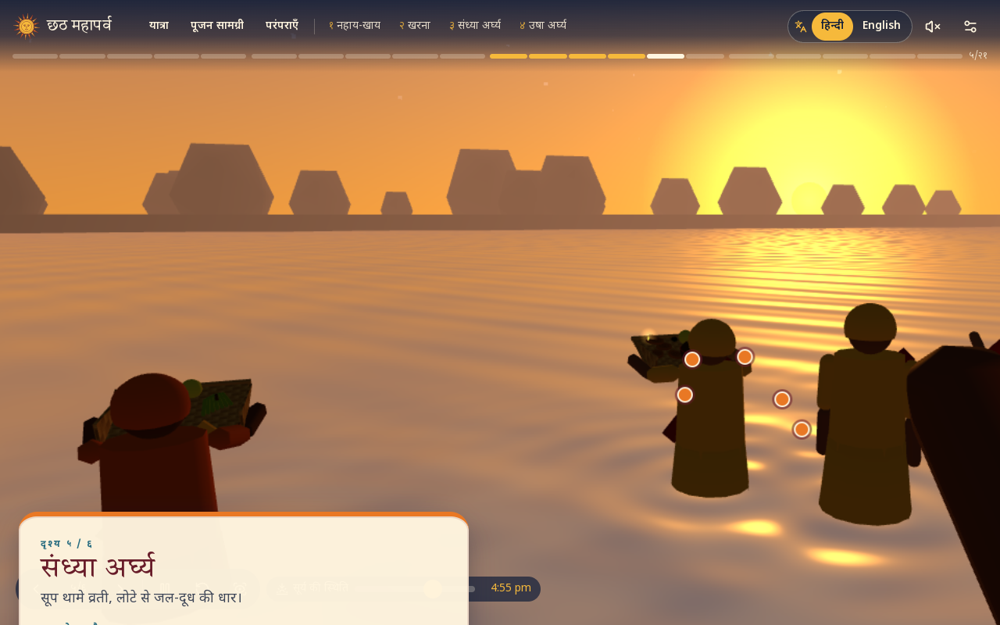
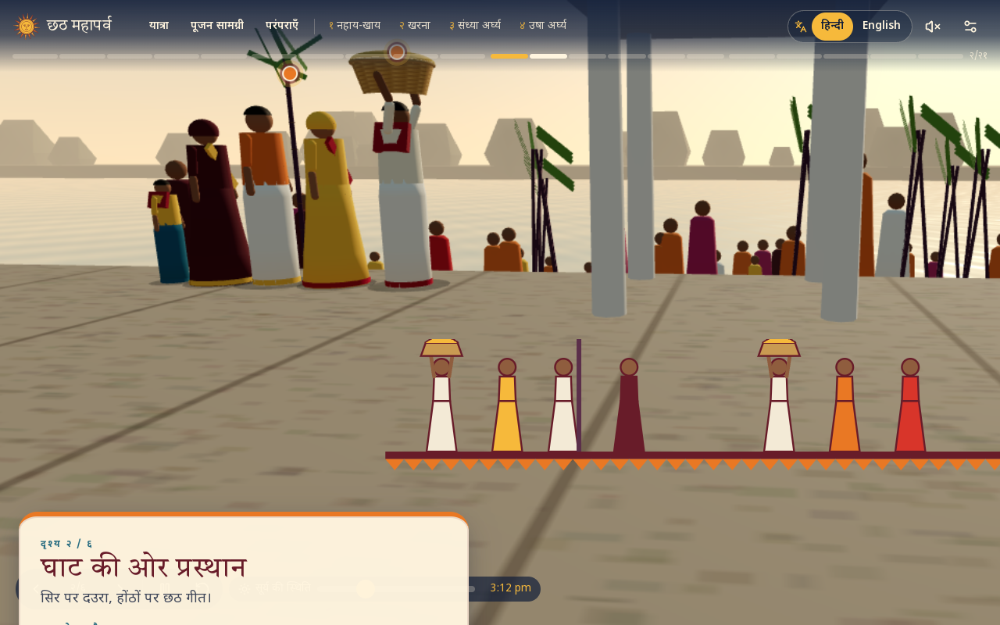

# Visual audit: characters, animation, lighting, environments

Status: **audit complete · realistic assets not yet acquired · no realism upgrade shipped yet.**
"Before" frames are in [`docs/audit/`](audit/). They come from the CI smoke test (commit `4eea7df`, same camera presets the "after" frames must reuse).

| Scene | Before |
|---|---|
| Day 3 · scene 5 · संध्या अर्घ्य (`ghat-closeup`, 16.75 h) |  |
| Day 3 · scene 2 · procession (`ghat-path`) |  |

---

## 1. What the characters actually are

Checked with a code search: the project contains **0** `SkinnedMesh`, **0** `Skeleton`/bones, **0** `AnimationMixer`/`AnimationClip`, **0** `.glb`/`.gltf` files, and `public/` has no model directory.

Every human is `src/three/Devotee.tsx`, a hierarchy of `THREE.Group` transforms holding **16 primitive meshes**:

| Body part | Current geometry (Devotee.tsx) | Why it reads as cartoon |
|---|---|---|
| Saree / dhoti | one `LatheGeometry` cone (6 profile points, 12–14 segments) | A rigid bell with no drape, pleats, pallu volume or legs |
| Hem border | open `cylinderGeometry` band | A flat ring |
| Torso | `cylinderGeometry(0.17, 0.19, 0.46, 10)` | A tube with no shoulders, chest or waist |
| Pallu | `boxGeometry(0.08, 0.55, 0.04)` laid diagonally | A plank, not cloth |
| Arms | 2 × 2 `capsuleGeometry` (upper arm + forearm) | No hands or fingers at all, so nothing can grip a soop or lota |
| Head | `sphereGeometry(0.11)` | No face, eyes, nose, mouth, ears or neck |
| Hair / ghoonghat | partial sphere caps | A helmet shape |
| Bindi | 0.012 sphere | — |
| Shadow | transparent disc | Fake contact shadow, which reinforces the floating look |

Proportions: total height ≈ 1.6 m with a 0.22 m head, about **7.3 heads tall**, which is close to adult proportions. Even so, there is no neck, the shoulders are 0.4 m apart inside a 0.19 m-radius torso, and arms hang from the torso edge. Children are the adult mesh scaled ×0.62 (same proportions), so they read as small adults.

Crowd (`GhatEnvironment › Crowd`): 70–140 instanced **lathe cones + spheres**, with no arms and no animation.

## 2. What the animation actually is

* There is **no skeletal animation**. `Devotee` blends 9 numbers per frame (shoulder pitch/roll, elbow, torso lean, a "sit" scalar, head pitch) toward targets from a 17-entry `POSES` table. Rotations are Euler angles on group nodes.
* "Walking" moves the whole body along a path and adds `sin(t·6)` arm swing and bob. **There are no legs**, so feet can't plant and everything slides.
* Sitting squashes the skirt lathe (`scale.y × 0.38`) and lowers the body.
* Held objects (soop, lota, daura) are **children of the body group at fixed offsets**. They aren't attached to hands (there are none), so hand–object contact is impossible.
* The arghya stream is a cylinder whose visibility is toggled.
* Choreography (`choreography.ts`) is good and **reusable**: a pure `(animation, progress, t) → {pos, rotY, pose, hold}` timeline per actor. Its *positions and timing* survive the upgrade. Its *pose ids* must map to authored clips.

## 3. Lighting, materials, environment

| Area | Current | Cartoon contributors |
|---|---|---|
| Lighting | 1 directional + hemisphere + ambient; shadow maps on "high" only; ACES tone mapping | Flat fill with no environment map, so skin and cloth look like matte plastic |
| Materials | `MeshStandardMaterial` with flat colours; 8 procedural `CanvasTexture`s ≤ 512 px | Saturated flat colours, no albedo variation, no normal/roughness maps |
| Water | custom single-pass shader (fresnel, glitter, ripples) | Reflections are sky-only, and devotees have no wet-cloth response |
| Sky / sun | gradient sky shader + sun sprite | Acceptable; needs an HDR environment for lighting |
| Ghat | box steps with stone canvas texture, cylinder chhatris, icosahedron trees | Low geometric detail; trees are crystals |
| Props | lathe/primitive soop, daura, lota, kalash, diya, sugarcane | Readable but toy-like |
| AO / post | none | No grounding, so objects float |

**Root cause:** the cartoon look comes from the *assets*, not from styling. No amount of material tweaking will make a sphere-headed, handless lathe figure look human. The fix requires real rigged human meshes and authored clips.

---

## 4. Why I have not shipped "realistic" characters yet

The sandbox I work in has **no outbound network** (npm, CDNs, asset stores and Mixamo are all blocked). I cannot download, buy or export any model, and I won't pass off primitive geometry as realistic. Building photoreal humans procedurally in code isn't feasible either: realistic faces, skin, hands and sarees need scanned or sculpted assets.

So the following must be **acquired by you** (or a 3D artist), and then I can integrate them.

## 5. Asset acquisition plan (recommended route first)

### Route A (recommended): MetaHuman → Blender → optimized GLB
* Since the **MetaHuman 5.6 EULA update (June 2025), MetaHumans may be used in any engine**, including commercial web projects ([MetaHuman licence](https://www.metahuman.com/license), [5.6 release notes](https://dev.epicgames.com/documentation/en-us/metahuman/metahuman-5-6-release-notes)). Free.
* Gives realistic South Asian faces and skin, real eyes, teeth and hair, and anatomically correct hands with a full finger rig.
* **Caveats:** MetaHuman clothing has no saree, so the saree must be modelled (Marvelous Designer is best) and skinned. Raw MetaHumans are far too heavy for the web, so you must export **LOD 3–5** and bake textures (see budgets below). Epic notes export outside Unreal "may experience issues".

### Route B: Character Creator 4 (Reallusion) + licensed export
* Paid. Realistic bases with Indian presets and a GLB/FBX export licence for real-time use.
* Includes a mature clothing workflow. A **saree still needs custom cloth**; several CC marketplace sarees exist, so check their licence for web redistribution.

### Route C: Commissioned scans or models
* Hire a 3D artist (ideally Indian, familiar with Chhath) to build 4–6 characters, or photogrammetry-scan consenting volunteers in festival attire. Best authenticity, highest cost.

### Animation (all routes)
* **Mocap is strongly preferred for ritual actions.** Record a vrati (with consent) performing: walking barefoot on steps, carrying a daura on the head, standing in water, holding and raising the soop, pouring from a lota, namaste, sitting cross-legged, stirring at a chulha, bowing / touching feet.
  * Low-cost options: Rokoko suit, Move.ai (phone video), or Plask. Clean up in Blender.
* Generic library clips (Mixamo, ActorCore) are acceptable **only** for walk / idle / sit / carry. Mixamo is free with an Adobe login and its clips may be used in projects; check the redistribution terms. **Do not use generic "prayer" or "offering" clips for arghya**, because they misrepresent the ritual.
* Cultural review of every ritual clip before release (see `CULTURAL_SOURCES.md`).

### What exactly to deliver (drop into the repo)

| File | Content | Budget (glTF, Meshopt + KTX2) |
|---|---|---|
| `public/models/characters/vrati_a.glb` | Adult woman, yellow saree with red border, pallu over head, sindoor | High LOD ≤ 25k tris · Low LOD ≤ 6k · 2k/1k textures · ≤ 3 MB |
| `vrati_b.glb`, `vrati_c.glb` | Two more vratis, different age, face and saree colour | same |
| `elder_woman.glb` | Elderly woman, maroon saree | same |
| `man_dhoti.glb` | Man in dhoti-kurta with gamchha | same |
| `young_man.glb` | Young man, kurta-pyjama | same |
| `child_boy.glb`, `child_girl.glb` | Real child proportions (not scaled adults) | ≤ 15k tris |
| `crowd_*.glb` (×4) | Background variants | ≤ 3k tris, 512 px |
| `public/models/anims/chhath_clips.glb` | One skeleton, clips: `idle_stand`, `walk_barefoot`, `walk_steps_down`, `carry_daura_walk`, `carry_daura_idle`, `stand_in_water_idle`, `soop_hold`, `soop_raise_arghya`, `lota_pour`, `namaste`, `sit_crosslegged`, `sit_eat`, `stir_chulha`, `sweep`, `bow_touch_feet`, `give_prasad` | ≤ 2 MB total |

**Rig requirements:** one shared humanoid skeleton across all characters (Mixamo or UE5 naming; I'll add a name map), with finger bones, hand sockets named `hand_r_grip` / `hand_l_grip`, and +Y up in metres.

## 6. What I will build once assets exist (no UX changes)

1. **`CharacterRig` component** replaces `Devotee`. It uses `useGLTF` with the Meshopt decoder and KTX2 loader, `SkeletonUtils.clone` per instance (one GPU geometry, many skeletons), and `useAnimations` with a crossfading `AnimationMixer`.
2. **Clip map:** `POSES` ids map to clip names, and the existing choreography keeps driving position and timing. Walk playback rate comes from path speed, so **feet stop sliding**.
3. **IK:** `CCDIKSolver` hand IK to soop handles and the lota neck (so hands actually grip). Foot IK and ground raycast against the ghat steps (no floating feet). Props attach to the `hand_*_grip` bones instead of the body.
4. **Water contact:** wet-cloth roughness/darkening below the waterline (shader chunk on the saree material), and ripples already exist in `Water.tsx`.
5. **Lighting:** a small HDR environment per time of day (≤ 256 px, PMREM), soft shadows (PCSS on high), and SSAO/N8AO on high only. Golden-hour key for Day 3; blue → warm ramp for Day 4 (the existing `sky.ts` already drives this).
6. **Quality tiers** (existing presets). High: full LOD, shadows, AO. Medium: LOD1, 1k textures, a shadow on the vrati only, 30 crowd. Low: LOD2 for the main four and pre-baked impostors for the crowd. Below low, the existing 2D fallback remains.
7. **Before/after harness:** the smoke test already renders every scene with fixed cameras; I'll add an `after/` capture of the same frames and a side-by-side page in this doc.

The existing hotspots, panels, scroll story, controls, language, audio and progress are untouched by any of the above. They're driven by `choreography.ts` and the store, not by the meshes.

## 7. Decision: Route A (MetaHuman). Status

| Step | Status |
|---|---|
| Rigged-character pipeline on the site (`src/three/characters/`): GLB loading (Meshopt), SkeletonUtils clones, clip cross-fades, stride-synced walk, props on hand/head bones, procedural fallback | ✅ built, verified in CI with a grey **test mannequin** (not realistic, CI-only) |
| Image-based lighting + soft shadows for PBR skin/cloth (on only when realistic characters exist) | ✅ built |
| Asset validator `npm run check:models` (rig, fingers, grip sockets, clips, budgets, licence) and optimiser `npm run models:optimize` | ✅ |
| Export guide for you: [METAHUMAN_GUIDE.md](METAHUMAN_GUIDE.md) | ✅ |
| `vrati_a.glb` + core clips (MetaHuman, saree, mocap) | ⏳ **waiting on you** |
| Hand IK, foot IK on steps, wet-saree material | ⏳ after the first real asset (needs the real skeleton to tune) |
| Before/after Sandhya Arghya with identical cameras | ⏳ after the first real asset |
